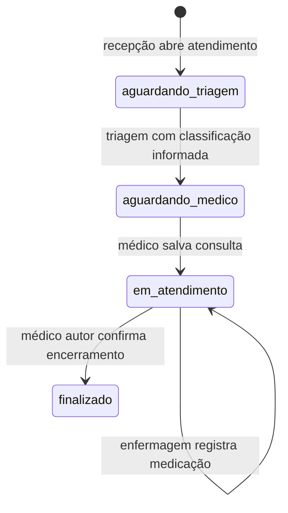
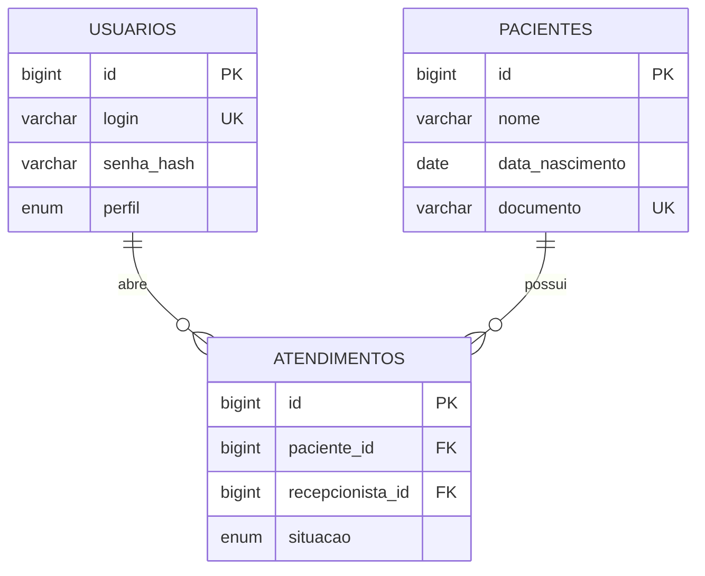
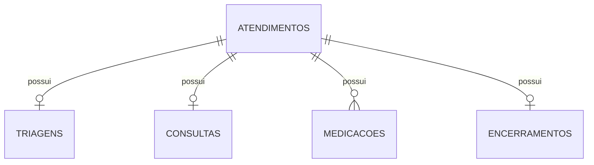

# Descrição técnica do sistema implementado

O PI2 é uma aplicação acadêmica em Node.js e MySQL. O navegador apresenta as páginas de cada área. O servidor confere sessão, perfil, origem e token de envio antes de encaminhar gravações aos módulos do domínio. Cada registro clínico aponta para um atendimento e para o profissional autenticado.

## Fluxo persistido

Medicação é uma etapa opcional no fluxo desta proposta. Depois do encerramento, novos registros clínicos são recusados. Repetições da mesma chave com os mesmos dados devolvem o resultado já salvo, sem criar cópias. Um paciente pode iniciar outro atendimento após encerrar o anterior.

## Entrada e identidade

## Registros do atendimento

Triagens e medicações guardam enfermeiro_id. Consultas e encerramentos guardam medico_id. Todas essas referências apontam para usuarios.id. As chaves estrangeiras e os índices completos estão nos arquivos SQL de database/. O texto do registro fica na visita, sem sobrescrever visitas anteriores do paciente.

## Permissões desta proposta

| Perfil     | Operações                                                                                                           |
| ---------- | ------------------------------------------------------------------------------------------------------------------- |
| Recepção   | Cadastro e busca de paciente, abertura de atendimento                                                               |
| Enfermagem | Fila de triagem, triagem e classificação informada, leitura do resumo e registro de medicações em atendimento ativo |
| Médico     | Fila após triagem, leitura do resumo, registro de consulta e encerramento da própria consulta                       |

A identidade vem da sessão. Os formulários não recebem o autor como um campo confiável. As consultas usam parâmetros SQL e o servidor só devolve os campos necessários. Sessões ficam em memória e vencem após oito horas ou ao reiniciar o servidor.

## Organização do código

src/ contém configuração, autenticação, HTTP e os módulos por função. public/screens/ mantém as mesmas telas refinadas durante o projeto. public/assets/ reúne os comportamentos e estilos compartilhados. database/ cria as tabelas de forma aditiva. scripts/ contém comandos de instalação e conferência. tests/ separa regras unitárias de integração com MySQL.

## Decisões que precisam do documento original

A classificação é escolhida pela enfermagem entre as opções do protótipo, sem cálculo por sinais vitais. A fila é ordenada pela abertura e exibe a classificação. Os campos e a distribuição fina de permissões são propostas baseadas nos cartões. O texto completo dos requisitos, o MER do grupo e os comentários da orientadora não foram disponibilizados. Portanto, este texto descreve o código entregue e deve ser incorporado ao trabalho original depois dessa conferência.

## Integridade acrescentada na evolução do banco

`database/restricoes.sql` define sete CHECKs para medidas e textos obrigatórios. `scripts/restricoes-banco.js` consulta o catálogo e aplica apenas as regras ausentes durante `npm run preparar`, inclusive em instalações anteriores. As chaves estrangeiras e as sete tabelas dos diagramas permanecem válidas. Os limites numéricos são técnicos e não definem classificação de risco. Requer MySQL 8.0.16 ou superior. Registros antigos incompatíveis interrompem a alteração correspondente para revisão, sem exclusão ou correção automática. Alterações DDL anteriores dessa mesma execução podem já ter sido aplicadas.

## Abertura de visitas simultâneas

A abertura usa READ COMMITTED apenas na transação atual. Isso evita a disputa de intervalos vazios observada ao abrir visitas de pacientes diferentes. A linha de pacientes continua com FOR UPDATE, serializando duas aberturas da mesma pessoa. O índice único da chave de tentativa permanece ativo. O teste de regressão reproduz a concorrência com duas conexões reais e confirma que ambas as pessoas podem abrir suas visitas. Referência: [MySQL, Transaction Isolation Levels](https://dev.mysql.com/doc/refman/8.0/en/innodb-transaction-isolation-levels.html).
